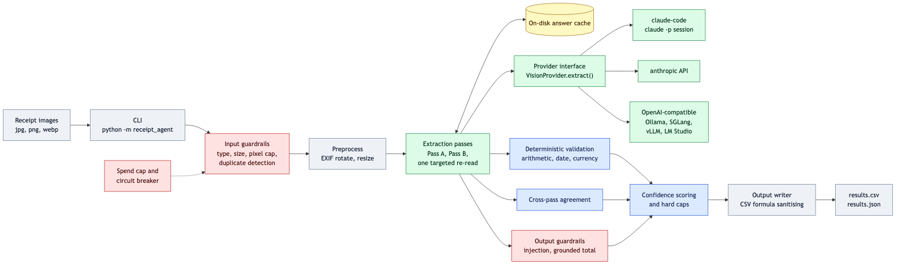
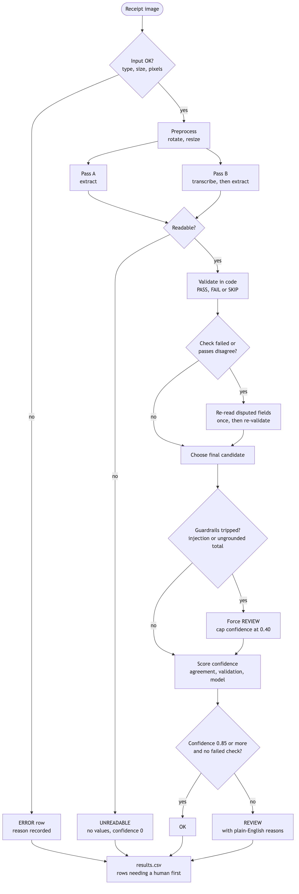
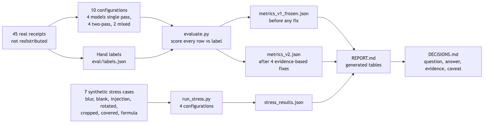
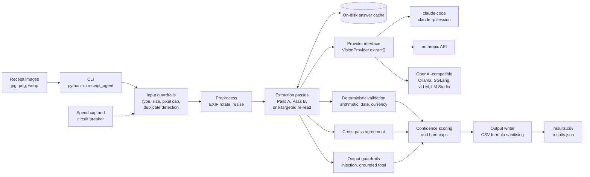

# Architecture



The pipeline is deliberately **not** multi-agent. Every receipt follows the same fixed steps, and the most important check
(does the arithmetic add up?) is plain code. The only non-determinism is the model call, and the system treats model output
as untrusted until code has checked it. See [DECISIONS.md](DECISIONS.md#q11-why-not-a-multi-agent-design) for the reasoning.

## Per-receipt flow



1. **Input guardrails.** Reject empty, wrong-type, corrupt, oversized or decompression-bomb files before any paid call.
2. **Preprocess.** Fix EXIF rotation, convert to RGB, bound the longest edge to 1600 px, re-encode as JPEG.
3. **Pass A and Pass B.** Two independent readings with different prompts. Pass B must first transcribe every line of text,
   then extract. The transcript is later used to check that the total was really printed.
4. **Readable?** Unreadable if both passes say `legible=false`, or neither found a vendor nor a total.
   An unreadable receipt gets no values and confidence 0. Nothing is guessed.
5. **Validate in code.** Every check returns PASS, FAIL or SKIP. A missing field is SKIP ("cannot verify"), never a pass.
6. **Re-read once.** Only if a check failed or the passes disagree. The re-read prompt lists the problems and the earlier
   readings, and forbids changing a number just to make the arithmetic work. The best candidate among A, B and the re-read
   wins (fewest weighted failures, then most agreement with the others).
7. **Output guardrails.** Injection flags and the grounded-total check can force REVIEW and cap confidence at 0.40.
8. **Score and write.** Rows that need a human sort first, then by ascending confidence.

## Where things live

| Concern | File |
|---|---|
| CLI and flags | `receipt_agent/cli.py` |
| Orchestration, concurrency, per-file error boundary | `receipt_agent/pipeline.py` |
| Extraction schema (one Pydantic model for every backend) | `receipt_agent/schema.py` |
| Prompts: system, Pass A, Pass B, re-read | `receipt_agent/prompts.py` |
| Model backends | `receipt_agent/providers/` (`anthropic_provider.py`, `claude_code_provider.py`, `openai_compat.py`, `base.py`) |
| Image loading and normalisation | `receipt_agent/preprocess.py` |
| Deterministic validation | `receipt_agent/validate.py` |
| Agreement between passes | `receipt_agent/compare.py` |
| Confidence and status | `receipt_agent/score.py` |
| Guardrails | `receipt_agent/guardrails.py` |
| Answer cache | `receipt_agent/cache.py` |
| CSV / JSON output | `receipt_agent/output.py` |
| Evaluation against labels | `receipt_agent/evaluate.py`, `eval/` |

## What the model is asked to return

One schema for every backend: `legible`, `transcript` (Pass B only), `vendor`, `date` (ISO) and `date_raw` (as printed),
`currency` (ISO 4217) and `currency_symbol_raw`, `line_items[]` (description, quantity, line total), `subtotal`, `tax`,
`other_charges` (service charge, tip, rounding), `total`, `prices_include_tax`, per-field `field_confidence`,
`suspicious_instructions`, `notes`. Anything not clearly printed must be `null`.

## Providers: one interface, three adapters

```python
class VisionProvider(Protocol):
    spec: str   # "backend:model", used for the cache key and reports
    def extract(self, image: bytes, media_type: str, system: str, user: str, schema: dict) -> dict: ...
```

| Backend | How structured output is obtained | Status |
|---|---|---|
| `claude-code` | `claude -p --json-schema`, session limited to the Read tool, MCP servers / skills / user settings off | **tested live** |
| `anthropic` | one forced tool call whose input schema is the extraction schema | unit-tested only (no API key) |
| `ollama`, `sglang`, `vllm`, `lmstudio`, `openai` | `response_format: json_schema`; on HTTP 400 falls back to prompting for JSON and parsing leniently | tested against a fake server only |

Adding a backend means writing one class with `extract()` and registering it in `providers/__init__.py`. See
[TESTED_ON.md](TESTED_ON.md) for exactly what was and was not run, and why.

## Validation checks

| Check | Weight | Passes when |
|---|---|---|
| `has_total` | 3 | a total was extracted |
| `items_vs_subtotal` | 3 | items sum = subtotal, or = subtotal + tax (tax-exclusive subtotal beside tax-inclusive items) |
| `subtotal_tax_total` | 3 | subtotal + other charges (+ tax) = total, either tax reading accepted |
| `items_vs_total` | 3 | no subtotal printed: items + other charges (+ tax) = total |
| `amounts_sane` | 2 | no negative total/subtotal/tax, total > 0, tax <= total |
| `has_vendor`, `has_date`, `date_plausible`, `has_currency`, `currency_valid`, `currency_matches_symbol`, `tax_plausible` | 1 each | present and sensible (date not future and not before 2000; ISO 4217 code; printed symbol such as `RM` agrees with the code; tax between 0 and 30% of the base) |

Tolerance is 0.05 in currency units, which absorbs cash rounding to the nearest 0.05. Unpriced line items (a "voucher
issued" line) do not break a sum that otherwise matches; if the sum does not match and some lines have no price, the check
is SKIP, not FAIL.

## Confidence and status

`confidence = 0.40 x agreement + 0.35 x validation pass-rate + 0.25 x model field confidence`, normalised if agreement is
unavailable, then capped:

| Condition | Cap |
|---|---|
| total missing | 0.30 |
| a guardrail tripped (injection, ungrounded total) | 0.40 |
| arithmetic check failed | 0.45 |
| vendor, date or total differ between passes | 0.55 |
| arithmetic could not be verified at all | 0.70 |
| only one pass (by choice or because Pass B failed) | 0.70 |

Status: `OK` if confidence >= 0.85 and no check failed; `REVIEW` otherwise; `UNREADABLE`; `ERROR` (rejected input or
extraction failed); `SKIPPED` (spend cap or circuit breaker). The weights are hand-chosen and **not tuned** on the labels.
An image-quality score is computed and written to the CSV, but carries weight 0: it did not discriminate on this data
([DECISIONS.md](DECISIONS.md#q5-what-does-confidence-mean-is-it-calibrated)).

## Failure handling

| Situation | What happens |
|---|---|
| One file is corrupt or a model call fails | that row becomes `ERROR` with the reason; the batch continues |
| Backend keeps failing | circuit breaker opens after N consecutive failures; remaining rows are `SKIPPED` with the reason |
| Spend cap reached | new receipts are `SKIPPED` with the reason; cache replays do not count as spend |
| Model returns malformed JSON or a schema violation | counted as a failed pass; the other pass can still carry the row (confidence capped) |
| Same file supplied twice | both are processed; the later one is flagged `REVIEW` as a duplicate |

## Caching and concurrency

Raw model answers are cached on disk, keyed by a hash of backend+model, pass label, system prompt, user prompt and image
bytes. Changing validation or scoring therefore costs nothing to re-run, and changing a prompt invalidates exactly the
calls it affects. Receipts are processed in a thread pool (default 4 workers); each model call is a blocking call or
subprocess. The cache holds receipt text (including any card digits or names), so treat `out/cache/` as sensitive.

## Evaluation harness



Metric definitions, matching rules and their limits are in [METRICS.md](METRICS.md).

## Diagram sources

The diagrams are Mermaid, so GitHub renders them inline and they diff cleanly. Sources are in `docs/diagrams/`; the PNGs
were rendered from them with `@mermaid-js/mermaid-cli`:

```bash
npx -y @mermaid-js/mermaid-cli@11 -i docs/diagrams/architecture.mmd -o docs/img/architecture.png -s 2 -b white
```

<details><summary>architecture.mmd</summary>


</details>
